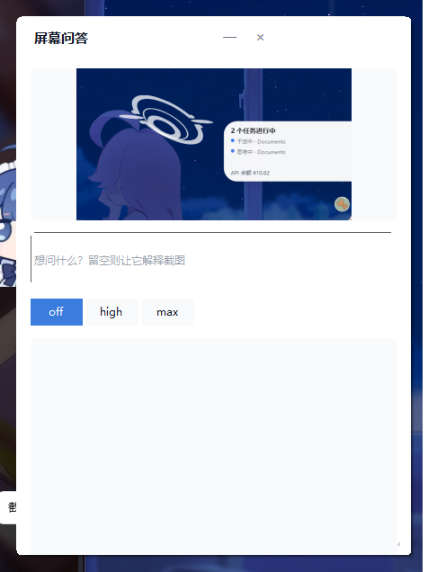

# DSH Screen Ask / 屏幕问答

Hold **X**, drag a rectangle over anything on screen, and ask a vision model about it. The answer appears in a **floating desktop window** (a native WinForms window, not a page overlay — it can be dragged anywhere, resized, minimized) and is also written back into the **current DSH conversation** as a `【屏幕问答】` message.

按住 **X** 键 + 左键拖拽框选屏幕任意区域，截图会进入一个**独立的桌面悬浮窗**（可拖出 DSH 窗口、可缩放、可最小化），向视觉模型提问后答案显示在悬浮窗里，同时以 `【屏幕问答】` 消息写回当前会话。




## Features / 功能

- **Global hotkey**: hold `X` (configurable in Settings → Plugins → 屏幕问答: `x`, `f9`, `ctrl+shift+x`, `side`, `mouse5` …) and drag with the left button; release the key to cancel. Changes apply within a second, no restart.
- **Silent background helper**: a tiny .NET program hooks the keyboard and captures the region — no console window, no taskbar entry.
- **Floating desktop window**: starts as a round whale orb (not in the taskbar); double-click to expand. Drag it outside DSH, resize from the bottom-right corner, collapse with `—`. The window position is remembered.
- **Per-request reasoning effort**: `off / high / max`, independent of the main session.
- **Writes back into the session**: question + screenshot + answer are appended to the current conversation as a user message, so the model sees it on later turns.
- **No build step for users**: helper binaries ship with the bundle.

## Requirements / 依赖

- Windows 10/11 (the helper is a .NET Framework 4.x WinForms program).
- DeepSeek Harness with a vision-capable model route, default `deepseek-official / deepseek-flash` (supports `text` + `image` input).
- DSH Desktop (Web GUI also works; the desktop window is spawned by the host process).

## Install / 安装

### Option A — plugin manager (recommended)

```text
plugin_manager action: install_bundle target: <absolute path to this repo>
```

### Option B — manual profile link

1. Add to the profile's `package.json` dependencies: `"dsh-screen-ask": "link:D:/path/to/dsh-screen-ask"`.
2. Append `dsh-screen-ask` to `dsh.profile.bundles`.
3. Create a junction under `profiles/<name>/node_modules/dsh-screen-ask` pointing at this directory.
4. Restart DSH.

After install, check that the plugin is active and the whale orb appeared.

## Configuration

Config lives in `cordis.patch.yml` under the plugin entry:

| Key | Default | Meaning |
| --- | --- | --- |
| `holdKey` | `x` | Initial trigger key: `x`, `f9`, `ctrl+shift+x`, `side`, `mouse4/5` … (changeable at runtime in Settings → Plugins) |
| `sideButton` | `1` | Side button number when `holdKey: side` (1 = back, 2 = forward) |
| `provider` | `deepseek-official` | LLM provider route |
| `model` | `deepseek-flash` | Model id (must accept image input) |
| `reasoningEffort` | `off` | Default reasoning effort for the floating window |
| `efforts` | `off, high, max` | Options shown in the panel |
| `outDir` | `~/Documents/dsh-screen-ask` | Capture/event/log directory |
| `prompt` | see file | Prompt prefix prepended to your question |

## How it works

```
 X held + drag ──▶ ScreenSnap.exe (global hooks, selection overlay)
                     │  writes snap-*.png + events.jsonl + last-capture.txt
                     ▼
              DSH plugin host (index.js)
                     │  tails events.jsonl, answers via ctx.llm.stream,
                     │  appends a user message via ctx.sessions.append
                     ▼
               Panel.exe (native window)
                     │  reads last-capture.txt, writes panel-request.txt
                     ▼
              panel-answer.txt ──▶ answer rendered in the window
```

- `ScreenSnap.exe` is spawned by the plugin host, hides its own console, and exits when the plugin heartbeat goes stale.
- `Panel.exe` is a separate GUI process (double-click the orb to expand, right-click for menu). It quits when DSH stops updating the heartbeat.
- The in-page overlay `client.js` is only a fallback launcher chip; all normal interaction happens in the desktop window.

## Build the helper (optional)

Only needed if you change the C# sources under `src/`.

```powershell
powershell -ExecutionPolicy Bypass -File scripts/build-helper.ps1
```

The script uses the .NET Framework 4 `csc.exe` and writes `helper/ScreenSnap.exe`, `helper/Panel.exe` and `helper/Bootstrap.exe`.

## Notes / 注意

- **Integrity level matters.** Low-integrity processes cannot receive low-level input hooks from normal windows. If you build/copy the helper into a folder carrying a `Low` mandatory label, the hotkey will only work when the helper's own window has focus. Fix with:
  ```powershell
  icacls <folder> /setintegritylevel "(OI)(CI)M" /T
  ```
- The client bundle is cached per package version. After editing `client.js`, bump `version` and reinstall (`remove_bundle` + `install_bundle`), then hard-refresh the page.
- The orb icon `helper/orb-whale.png` is derived from the DSH tray icon and is intended for personal use; replace it if you redistribute the plugin under stricter brand rules.
- The screenshot never leaves your machine except as the image you explicitly send to the configured model.

## License

MIT
